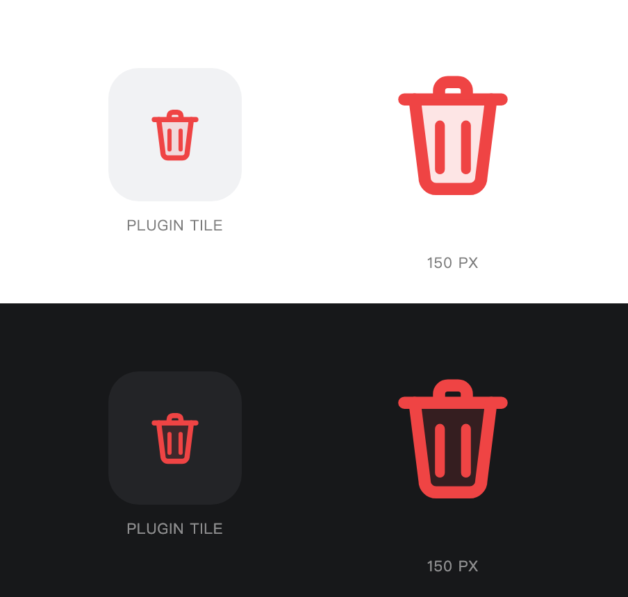

# Delete session · dsh-delete-session

[](https://github.com/Rayzenchen/dsh-delete-session/actions/workflows/ci.yml)
[](LICENSE)


Adds one row to DeepSeek Harness's sidebar session menu: **Delete session**. One click on a session's "…" menu, one confirmation, and the session is really gone — transcript, subagent sessions, projection cache and workspace references together.



DeepSeek Harness (DSH) ships with **Archive**, but archiving only moves a session out of the sidebar: the files stay on disk, stay searchable, and keep taking space. This plugin is that missing step.

- Version: **1.0.0**
- Requires DSH **0.2.2 or newer** (web and desktop)
- A Host half and a Client half, one plain JavaScript file each — no build step, no runtime dependencies

## What it deletes, and what it leaves alone

| Deleted | Kept |
| --- | --- |
| The session directory (every `.jsonl.zstd` log and lock file) | Sessions forked from it: a fork is an independent session — it records `parentSession`, but it is not a subagent |
| Its **subagent sessions** (descendants with `origin: 'subagent'`) | Attachments: content-addressed by sha256 and shared across sessions, so deleting them would damage others |
| The projection-cache record | The workspace directory itself, other sessions, other workspaces |
| Workspace-registry references, archive and pin records | Files in your repository (the plugin only touches session data under `~/.dsh`) |

Deletion is **permanent**. There is no recycle bin and no undo.

## Install

1. Clone or download this repository to any directory:

   ```sh
   git clone https://github.com/Rayzenchen/dsh-delete-session.git dsh-delete-session-plugin
   ```

2. Have DSH install that directory. Ask it to run `plugin_manager`'s `install_bundle` with a `link:` spec:

   ```
   link:/absolute/path/to/dsh-delete-session-plugin
   ```

   `link:` means "reference this directory instead of copying it", so editing files here edits the installed plugin.

3. **Restart DSH.** The Host half is imported once at startup and is not hot-reloaded; the Client half only needs a page refresh.

4. Open **Settings → Plugins** and check that `@local/dsh-delete-session` is enabled with a red trash-can icon.

> Upgrading an existing install: Host changes need a restart, UI copy and menu rows need only a refresh.

## Using it

1. Sidebar session row → "…" → the last row, **Delete session** (red, trash icon, after the built-in Archive action).
2. A confirmation dialog opens, titled with the session name, stating that the session's transcript, subagent sessions and caches will be permanently deleted, and that the action cannot be undone.
3. Press **Delete**. Focus starts on **Cancel**; `Esc`, a click on the backdrop, or the ✕ also close it.
4. If the session still has work in flight the Host refuses and says why; the dialog then also offers **Stop work and delete**, which cancels that session's turn, background jobs, subagents and armed schedules, waits until it is genuinely idle (up to 15 seconds), and only then deletes.
5. A failure is shown inside the dialog rather than only in the console.

## Safety design

Deletion cannot be undone, so the rule here is: **refuse rather than delete the wrong thing, and never delete halfway.**

- **It protects work, not residence.** Only work that is actually running blocks a delete — an active turn, a running job or subagent, an armed schedule — all reported by DSH's own `workspace/session-activity` service. A session that was merely opened once and is idle deletes normally, with no restart.
- **Every refusal happens before anything is touched.** Work in flight, a missing directory, or a failed check all return before the disk changes.
- **Fence first, remove bytes second.** After the checks pass, the session is written into DSH's archive set, which is what the session controller's turn-admission gate reads. From that moment a finished job, a firing schedule, or a message from another window can no longer wake it. Bytes are removed only after that succeeds.
- **Flush before deleting.** A still-live session is flushed first, so no buffered event is left pointing at a directory that is about to disappear.
- **No half-deletes.** Subagents go first and the main session last; each target is removed and then re-checked with `lstat`. If the main session survives, the response is `500 partial`, the session is kept, and its archive/pin state is restored.
- **Rollback is exception-safe.** Flush, sizing, removal and re-check all sit inside `try/finally`, so the rollback runs on every path that leaves the main session in place. A re-check that fails with `EACCES`/`EPERM`/`ELOOP` counts as *not deleted*: keeping a record whose bytes may be gone is recoverable, hiding one that still has bytes is not.
- **Fail closed on checks.** An unreadable session list or an unanswerable activity check returns `503` instead of being treated as "idle".
- **Client-supplied paths are never trusted.** The request carries a session id only, matched against `^[A-Za-z0-9._-]{1,256}$` with `.` and `..` rejected outright. The directory is re-derived from that id using DSH's own `encodeSegment` / `projectKey` rules, then proven to sit inside the sessions root with `realpath`; symlinks are rejected.
- **Server-side confirmation.** The body must carry `confirm: true`; a pressed button is not enough.
- **It reuses DSH's own request trust model.** The route does not invent a second policy: it calls `connection.admit(req)` — loopback/trusted Host, `Origin == Host`, `sec-fetch-site`, signed HttpOnly cookie — and additionally requires an `x-dsh-plugin` header that a cross-site page cannot send without a preflight. Measured: an unauthenticated request returns `401`, a cross-origin one `403`, and `GET` returns `405`.
- **One delete per session at a time.** Two windows deleting the same session: the second gets `409 busy`.

## Known limitations

- **No recycle bin.** Permanent by design. To keep one, replace `rm(...)` with `rename(...)` into `~/.dsh/trash/sessions/`.
- **A deleted session's in-memory object lives until the next restart.** DSH registers Agents on an app-lifetime registry and the plugin has no dispose entry point (none of `sessionController`'s 19 methods on 0.2.2-rc.5 deletes or disposes a session). The bytes are gone and the sidebar row never returns, but an idle object occupies memory until DSH restarts.
- **A running session cannot be deleted directly** — it must be stopped first. That is deliberate.
- **No agent tool.** Deleting is an irreversible human decision, so it is deliberately not callable by a model.
- **Host changes need a restart.** The Host half is imported once at startup; the Client half is read from disk on every page load.
- **Verified on macOS only.** Path handling, deletion and rollback are covered by tests, but the live machine run has only happened on macOS.

## Diagnostics

Every delete and every ghost query appends one JSON line to the system temporary directory:

```
$TMPDIR/dsh-delete-session-diagnostics.jsonl        # capped at 256 KB, truncated past that
```

Each line carries `build` (the plugin version), `op` (`start` / `delete` / `ghosts` / `list-hidden` / `rejected` / `internal-error`) and the liveness view at that moment. A failed write never breaks the feature; a symlink planted at that path is skipped (`O_NOFOLLOW`, mode `0600`).

It is more reliable than the log here, because the macOS desktop app's Host stdout is not persisted.

## Verification

```sh
npm install     # React 18 / jsdom, for the tests only; the plugin itself has no dependencies
npm test        # 6 suites, 147 assertions
```

| Suite | Assertions | Covers |
| --- | --- | --- |
| `tools/verify-paths.mjs` | 18 | Path derivation, traversal defense, symlink fence, ambiguous-directory refusal, per-directory re-check of the live session tree |
| `tools/verify-delete.mjs` | 50 | Deletion, byte accounting, removal notices, in-flight refusal, stop-then-delete, subagent cascade, fork protection, archive fence and rollback, partial failure |
| `tools/verify-host-filter.mjs` | 10 | The Host-side session-list filter that hides ghosts |
| `tools/verify-rollback-fault.mjs` | 3 | An injected `EACCES` during the re-check must not leave the session archived |
| `tools/verify-client-ghosts.mjs` | 32 | Ghost suppression, cross-window notices, connection-generation resync, no self-feeding renderer spin |
| `tools/verify-client-dialog.mjs` | 34 | The really-rendered dialog: copy mapping, accessibility attributes, Tab focus trap, partial-failure handling |

`verify-paths` and `verify-client-dialog` print `SKIP` instead of failing when their prerequisites are absent: the first needs session directories on this machine, the second needs `npm install` for React and jsdom.

**Live acceptance checklist** (worth running after moving machines or upgrading DSH):

1. Create a scratch session, send one message, let it finish — nothing valuable.
2. On that sidebar row: "…" → **Delete session** → **Delete**.
3. Confirm the row disappears and nothing reports an error.
4. Confirm the matching directory under `~/.dsh/sessions/` is gone.
5. Check the `op:"delete"` line in the diagnostics file; `build` should equal the plugin version.

## Layout

```
dsh-delete-session-plugin/
├── package.json          Manifest: version, icon, dsh.bundle.patch, dsh.client
├── cordis.patch.yml      Loader patch: inserts the id=dsh-delete-session row
├── index.js              Host half: deletion core + POST route (~1000 lines)
├── client.js             Client half: menu row + confirmation dialog (plain JS, no build)
├── locale/{zh,en}.json   Title and description shown by the plugin manager
├── icon.svg              Plugin icon (36×36, transparent)
├── docs/icon-preview.png The icon in light and dark themes
└── tools/                Six verification suites plus the verify-all runner
```

## Uninstall

Remove `@local/dsh-delete-session` in **Settings → Plugins**, or have DSH run `plugin_manager`'s `remove_bundle`.

Because the install uses `link:` (a directory reference, nothing copied), removing it leaves this directory behind — delete it yourself if you like. Sessions you already deleted do not come back.

## License

[MIT](LICENSE) © 2026 Rayzenchen
