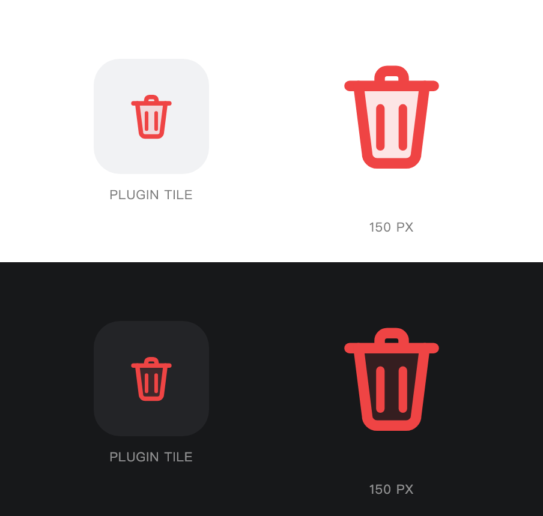

# 删除会话 · dsh-delete-session

[](https://github.com/Rayzenchen/dsh-delete-session/actions/workflows/ci.yml)
[](LICENSE)


给 [DeepSeek Harness](https://github.com/deepseek-ai) 的侧栏加一行「删除会话」：在会话行的「…」菜单里点一下、确认一次，这个会话就被**真正删掉**——对话记录、子代理会话、投影缓存和工作区引用一起清理。



DeepSeek Harness（下文简称 DSH）自带「归档」，但归档只是把会话从侧栏挪走，文件还在磁盘上、还能被搜索到、还在占空间。这个插件补的就是那一步。

- 当前版本：**1.0.0**
- 适用于 DSH **0.2.2 及以上**（Web 与桌面端）
- 单文件 Host 插件 + 单文件 Client 插件，无构建步骤、无运行时依赖

## 它删什么，不删什么

| 会删除 | 不会删除 |
| --- | --- |
| 会话目录（含全部 `.jsonl.zstd` 日志与锁文件） | 分叉（fork）出来的会话：它是独立会话，虽然记录了 `parentSession`，但不是子代理 |
| 该会话的**子代理会话**（`origin: 'subagent'` 的后代） | 附件：按内容（sha256）寻址、跨会话共享，删了会误伤别的会话 |
| 投影缓存记录 | 工作区目录本身、其他会话、其他工作区 |
| 工作区注册表里的引用、归档与置顶记录 | 你的仓库文件（插件只动 `~/.dsh` 下的会话数据） |

删除是**永久的**，没有回收站，删完无法恢复。

## 安装

1. 把这个仓库克隆或下载到本机任意位置：

   ```sh
   git clone https://github.com/Rayzenchen/dsh-delete-session.git dsh-delete-session-plugin
   ```

2. 让 DSH 安装这个目录。让它执行 `plugin_manager` 的 `install_bundle`，`target` 填目录的 `link:` 规格，例如：

   ```
   link:/绝对路径/dsh-delete-session-plugin
   ```

   `link:` 表示「直接引用这个目录，不复制文件」，所以之后在这个目录里改代码，就等于改已安装的插件。

3. **重启 DSH**。宿主那一半在启动时加载一次，改完不重启不生效；前端那一半刷新页面即可。

4. 打开「设置 → 插件」，确认 `@local/dsh-delete-session` 已启用，图标是一个红色的垃圾桶。

> 如果只是升级已装好的版本：宿主改动需要重启，界面文案与菜单项刷新页面即可。

## 怎么用

1. 侧栏任意会话行 →「…」→ 最后一行 **删除会话**（红色、垃圾桶图标，排在「归档会话」之后）。
2. 弹出确认框，标题就是会话名，正文写明「将永久删除会话「X」及其全部对话记录、子代理会话与缓存」，并提示「此操作不可撤销」。
3. 点「删除」→ 请求宿主执行。默认焦点在「取消」上；`Esc`、点遮罩、右上角 ✕ 都能关掉。
4. 如果该会话还有正在运行的工作，宿主会拒绝，并告诉你原因；对话框随之多出一个 **停止任务并删除** 按钮——它会先让 DSH 停掉那个会话的回合、后台任务、子代理和定时提醒，确认真的空闲（最多等 15 秒）后再删。
5. 失败时原因就地显示在对话框里（不是只在控制台），不会静默失败。

## 安全设计

删除是不可逆操作，所以这里的原则是：**宁可拒绝，也不要删错、删一半。**

- **保护的是「正在干活」，不是「开着」**：只有真正在进行中的工作会拦住删除——正在跑的回合、正在运行的后台任务或子代理、已武装的定时提醒。这些都由 DSH 自己的 `workspace/session-activity` 服务回答。**只是被打开过、当前空闲的会话可以直接删，不用重启 DSH。**
- **一切拒绝都发生在动手之前**：有任务在跑、找不到目录、检查失败——都在磁盘被改动前返回，不会「删了一半才开始报错」。
- **先封门，再删字节**：通过检查后先把会话写进 DSH 的归档集合（会话控制器的回合准入闸门读的就是它），从这一刻起，任务完成回调、定时提醒、别的窗口发来的消息都叫不醒它；只有这一步成功后才开始删文件。
- **删除前先落盘**：对仍然存活的会话先 `flush` 一次，把缓冲区里的事件写完，避免留下「待写入的缓冲区指向一个已消失的目录」。
- **不会删一半**：先删子代理、最后删主会话，每个目标单独执行并用 `lstat` 复核。主会话没删掉就返回 `500 partial`，会话本身保留、归档与置顶状态恢复。
- **回滚是异常安全的**：落盘、统计、删除、复核整段包在 `try/finally` 里，只要主会话没被确认删除就一定回滚；复核时报 `EACCES`/`EPERM`/`ELOOP` 一律按「未删除」处理——宁可留一条可能已经空了的记录，也不隐藏一个还有字节的会话。
- **检查失败即拒绝**（fail closed）：会话列表读不到、活动状态查不出来，都返回 `503` 而不是当作「空闲」继续删。
- **不信任客户端传来的路径**：请求里只有会话 id，且必须匹配 `^[A-Za-z0-9._-]{1,256}$` 并显式拒绝 `.` / `..`；目录由 id 按 DSH 自己的 `encodeSegment` / `projectKey` 规则重新派生，再用 `realpath` 证明它确实在会话根目录之内，并拒绝符号链接。
- **服务端确认标记**：请求体必须带 `confirm: true`，不是只靠前端按钮状态。
- **沿用 DSH 自己的请求信任模型**：路由不另造一套策略，而是调用 `connection.admit(req)`（回环/可信 Host + `Origin == Host` + `sec-fetch-site` + 签名 HttpOnly Cookie），另外要求一个自定义请求头 `x-dsh-plugin`（跨站页面无法在不触发预检的情况下带上它）。实测未认证请求返回 `401`，跨 Origin 返回 `403`，`GET` 返回 `405`。
- **同一会话同时只允许一个删除**：两个窗口同时删，第二个拿到 `409 busy`。

## 已知限制

- **没有回收站**：按设计是永久删除。想改成先移到 `~/.dsh/trash/sessions/`，把 `index.js` 里的 `rm(...)` 换成 `rename(...)` 即可。
- **被删会话的内存对象要等重启才彻底释放**：DSH 把 Agent 注册在应用级的注册表上，插件没有 dispose 入口（0.2.2-rc.5 的 `sessionController` 19 个方法里没有删除/释放），所以那个空闲对象会占一点内存直到下次重启。磁盘上的字节已经没了，侧栏也不会再出现它。
- **正在运行的会话不能直接删**：必须先停。这是刻意设计，不是缺陷。
- **不注册 agent 工具**：删除是不可逆的用户决定，故意只留给人点，模型调不到。
- **改了宿主那一半要重启 DSH**：宿主启动时 import 一次，不会热重载前端那一半刷新页面即可（它每次由 `clientModules` 从磁盘取）。
- **仅验证于 macOS**：路径处理、删除与回滚都有测试覆盖，但真机只跑过 macOS。

## 诊断

宿主每次删除、每次幽灵查询，都会往系统临时目录追加一行 JSON：

```
$TMPDIR/dsh-delete-session-diagnostics.jsonl        # 上限 256 KB，超出即清空
```

每行带 `build`（= 插件版本）、`op`（`start` / `delete` / `ghosts` / `list-hidden` / `rejected` / `internal-error`）以及当时的存活视图。写入失败不影响功能，路径上若被放了符号链接则直接跳过（`O_NOFOLLOW`，权限 `0600`）。

排查时它比日志可靠：macOS 桌面端的宿主 stdout 并不落盘。

## 验证

```sh
npm install     # 只为测试装的 React 18 / jsdom，插件本身零依赖
npm test        # 6 个套件，147 条断言
```

| 套件 | 断言 | 覆盖什么 |
| --- | --- | --- |
| `tools/verify-paths.mjs` | 18 | 路径派生、穿越防护、符号链接围栏、歧义目录拒绝、本机真实会话目录逐个复核 |
| `tools/verify-delete.mjs` | 50 | 删除、字节统计、通知、在跑拒绝、停止后删除、子代理级联、分叉保护、归档封锁与回滚、部分失败 |
| `tools/verify-host-filter.mjs` | 10 | 宿主端会话列表过滤（幽灵屏蔽） |
| `tools/verify-rollback-fault.mjs` | 3 | 复核阶段注入 `EACCES` 时不得停留在归档态 |
| `tools/verify-client-ghosts.mjs` | 32 | 前端幽灵行压制、跨窗口通知、连接代际重同步、防自我喂养空转 |
| `tools/verify-client-dialog.mjs` | 34 | 真实渲染的对话框：文案映射、无障碍属性、Tab 焦点锁、部分失败处理 |

`verify-paths` 与 `verify-client-dialog` 在没有相应条件时会打印 `SKIP` 而不是失败：前者需要本机有会话目录，后者需要 `npm install` 装上的 React/jsdom。

**真机验收清单**（换机器或升级 DSH 之后建议跑一遍）：

1. 新建一个会话，随便发一句，等它结束（别用有价值的会话）。
2. 侧栏那一行 →「…」→「删除会话」→「删除」。
3. 确认侧栏那一行消失，没有报错。
4. 确认 `~/.dsh/sessions/` 下对应的目录已经不存在。
5. 看一眼诊断文件里的 `op:"delete"` 记录，`build` 应该等于插件版本。

## 目录结构

```
dsh-delete-session-plugin/
├── package.json          清单：版本、图标、dsh.bundle.patch、dsh.client
├── cordis.patch.yml      Loader 补丁：插入 id=dsh-delete-session 这一行
├── index.js              Host 半边：删除逻辑 + POST 路由（约 1000 行）
├── client.js             Client 半边：菜单行 + 确认对话框（纯 JS，无构建）
├── locale/{zh,en}.json   插件管理页的标题与说明
├── icon.svg              插件图标（36×36，透明底）
├── docs/icon-preview.png 图标在明暗主题下的预览
└── tools/                6 个验证套件 + verify-all 汇总入口
```

## 卸载

「设置 → 插件」里移除 `@local/dsh-delete-session`，或者让 DSH 执行 `plugin_manager` 的 `remove_bundle`。

因为安装用的是 `link:`（目录引用、不复制文件），移除后会留下这个目录本身，可以自行删除。已经删掉的会话不会因为卸载而回来。

## 许可证

[MIT](LICENSE) © 2026 Rayzenchen
